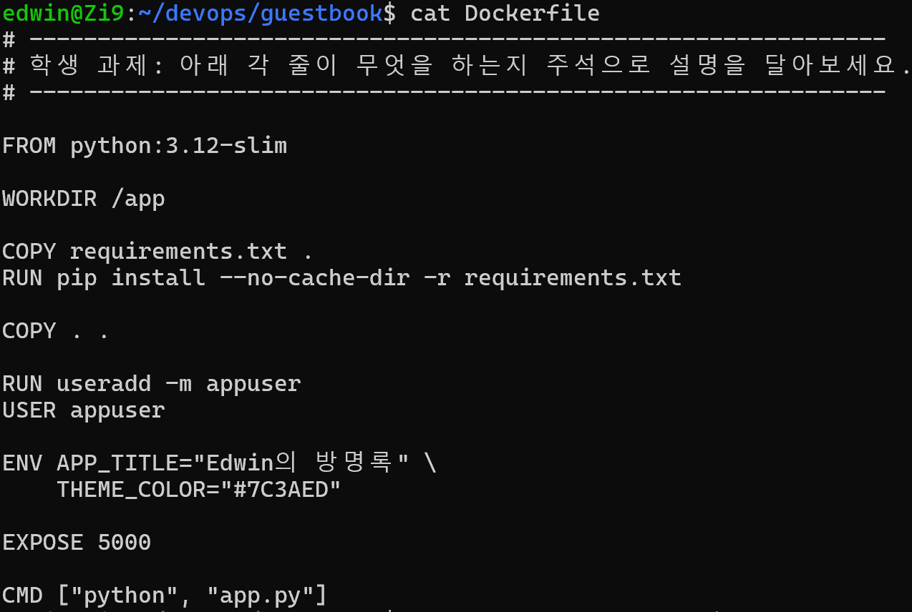
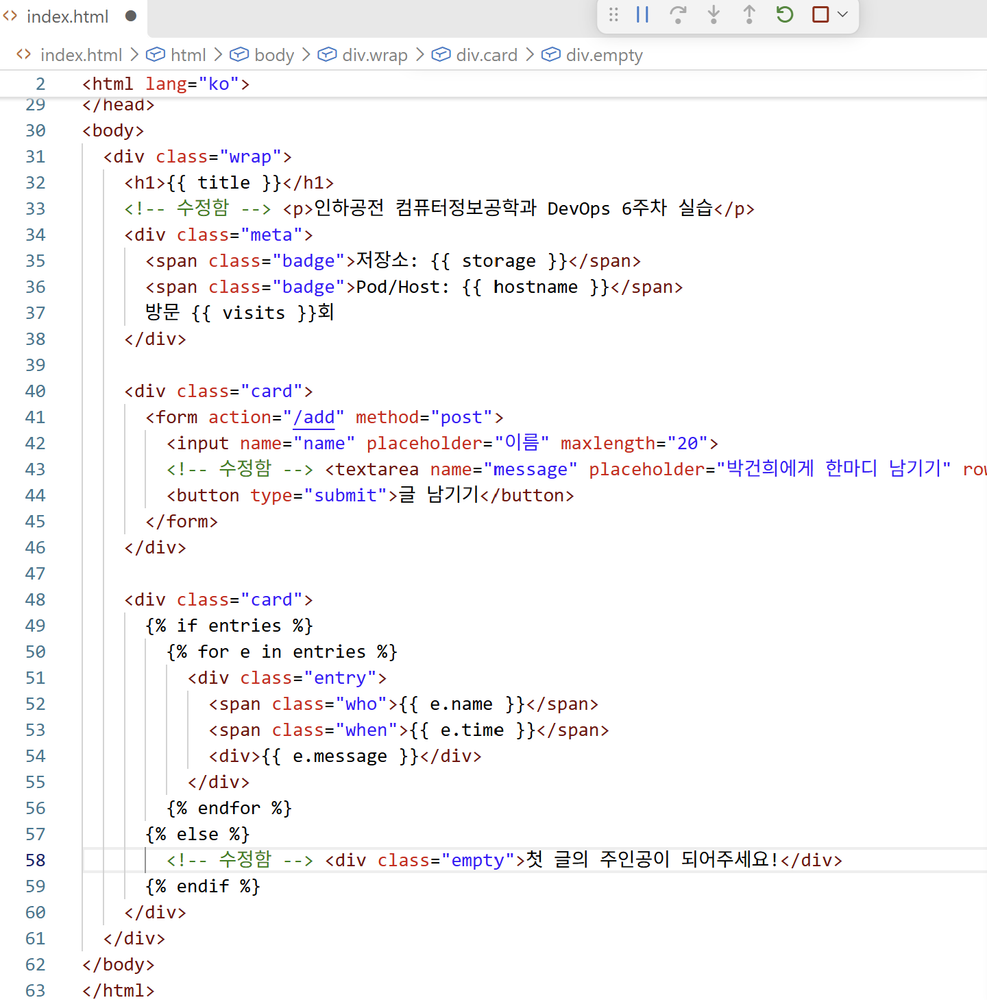
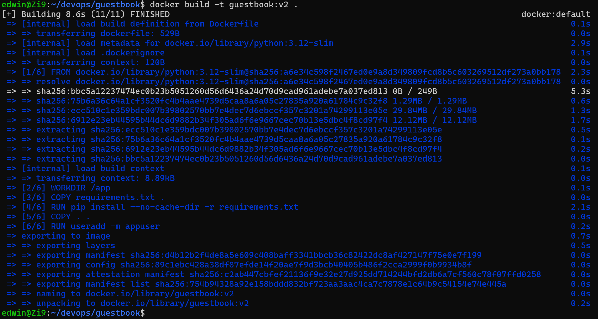
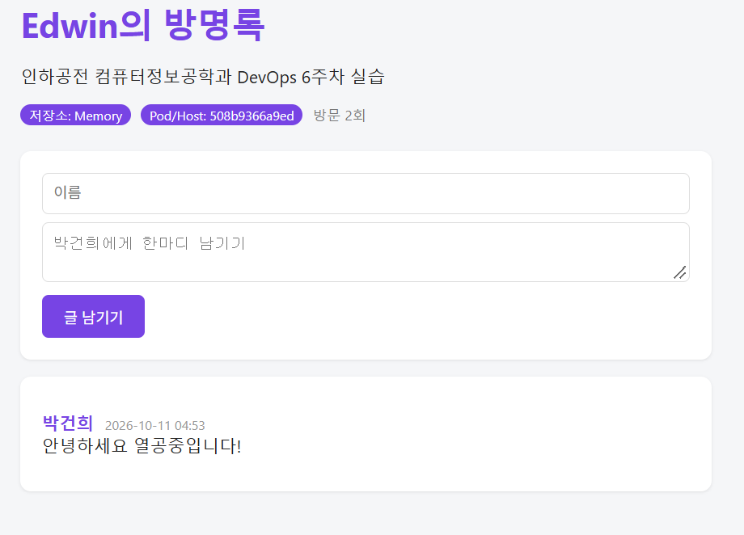
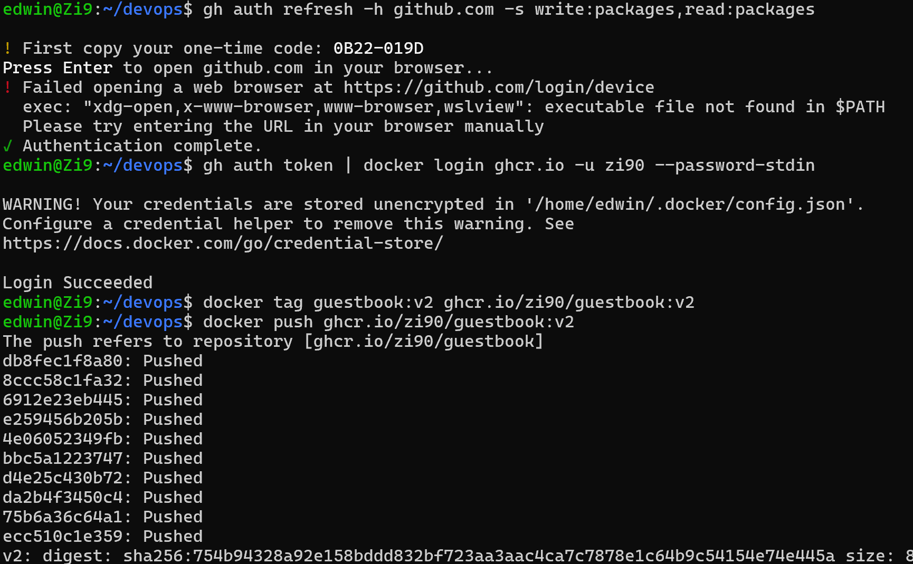

# 6주차 - 도커파일 (Dockerfile)

> 내 코드 + Dockerfile(레시피) → `docker build` → 나만의 이미지 → `docker push` → 누구나 `docker pull`

## 오늘 배운 내용

- **Dockerfile** = 이미지를 만드는 레시피. 실행 환경을 코드로 적어 두면 누구나, 몇 번이든 똑같이 만들 수 있다 (Infrastructure as Code)
- **이미지 주소 읽기**: `ghcr.io / zi90 / guestbook : v2` = 레지스트리 / 계정 / 이미지 이름 / 태그
  - 태그를 생략하면 `latest`를 요청한다. "가장 최신 버전"을 찾는 게 아니라 `latest`라는 이름의 태그를 찾는 것
  - 레지스트리를 생략하면 도커 허브
- **RUN vs CMD**: RUN은 이미지를 **만들 때** 한 번, CMD는 컨테이너를 **켤 때마다** 실행
- **EXPOSE**는 "이 컨테이너는 5000번을 쓴다"는 메모일 뿐. 실제로 열려면 `-p 8081:5000`
- **레이어와 캐시**: 명령 한 줄이 레이어 하나. 한 레이어가 바뀌면 그 아래 레이어는 전부 다시 만든다
- **설정 우선순위**: `app.py` 기본값 < Dockerfile `ENV` < `docker run -e`

## 내 이미지

| 항목 | 값 |
|---|---|
| 이미지 주소 | `ghcr.io/zi90/guestbook:v2` |
| 받아서 실행 | `docker run -d -p 8081:5000 ghcr.io/zi90/guestbook:v2` |
| 패키지 페이지 | https://github.com/Zi90?tab=packages |

## Dockerfile 한 줄씩 설명 (내 말로)

```dockerfile
FROM python:3.12-slim          # 파이썬 3.12가 깔린 가벼운 리눅스 이미지에서 시작한다
WORKDIR /app                   # 이후 명령은 /app 안에서 실행 (없으면 만들어 줌, cd와 비슷)
COPY requirements.txt .        # 라이브러리 목록만 먼저 복사한다 (캐시를 살리려고)
RUN pip install --no-cache-dir -r requirements.txt   # Flask, redis 설치. 결과가 이미지에 남는다
COPY . .                       # 나머지 코드 전부 복사 (.dockerignore에 적힌 건 빠짐)
RUN useradd -m appuser         # 일반 사용자 계정 만들기
USER appuser                   # root가 아닌 사용자로 실행 → 컨테이너가 뚫려도 피해를 줄임
ENV APP_TITLE="Edwin의 방명록" \
    THEME_COLOR="#7C3AED"      # 이미지에 구워 넣는 기본 설정값 (run -e로 덮어쓰기 가능)
EXPOSE 5000                    # 5000번 포트를 쓴다는 문서 (실제로 열지는 않음)
CMD ["python", "app.py"]       # 컨테이너가 켜질 때 실행할 명령 (배열 형태 권장)
```

## 실습 과정

### 1. 커스터마이징 (3곳 이상)

| 파일 | 바꾼 내용 |
|---|---|
| `Dockerfile` | 제목 `APP_TITLE="Edwin의 방명록"`, 색상 `THEME_COLOR="#7C3AED"`(보라) |
| `templates/index.html` 33행 | 제목 아래 "인하공전 컴퓨터정보공학과 DevOps 6주차 실습" 추가 |
| `templates/index.html` 43~44행 | 입력창 안내 "박건희에게 한마디 남기기", 버튼 "글 남기기" |
| `templates/index.html` 58행 | 빈 목록 문구 "첫 글의 주인공이 되어주세요!" |




### 2. 빌드

```bash
docker build -t guestbook:v2 .     # 끝의 점(.) = 현재 폴더를 빌드 컨텍스트로
```

FROM → WORKDIR → COPY → RUN pip → COPY . . → RUN useradd 순서대로 레이어 6개가 만들어졌다 (8.6초).



### 3. 실행과 확인

```text
$ docker images | grep guestbook
guestbook:v2         754b94328a92        201MB           49MB
$ docker run -d -p 8081:5000 --name gbv2 guestbook:v2
508b9366a9edacabb5955b97251d8ee321b3d0d83ccbf97bfe8111aecb1c7482
$ docker ps
CONTAINER ID   IMAGE          COMMAND           CREATED         STATUS         PORTS                                         NAMES
508b9366a9ed   guestbook:v2   "python app.py"   7 seconds ago   Up 6 seconds   0.0.0.0:8081->5000/tcp, [::]:8081->5000/tcp   gbv2
```

화면의 `Pod/Host: 508b9366a9ed`가 `docker ps`의 컨테이너 ID와 같다 → 컨테이너 안에서 실행 중이라는 증거.



### 4. ghcr.io에 푸시

```bash
gh auth refresh -h github.com -s write:packages,read:packages   # 패키지 권한 추가
gh auth token | docker login ghcr.io -u zi90 --password-stdin    # Login Succeeded
docker tag guestbook:v2 ghcr.io/zi90/guestbook:v2                # ghcr 주소는 소문자만
docker push ghcr.io/zi90/guestbook:v2
```

레이어 10개가 `Pushed`, digest `sha256:754b9432…`는 로컬 이미지 ID와 같다.



## 빌드 캐시와 명령어 순서

```dockerfile
# [나쁜 예] 코드 한 줄만 고쳐도 pip install을 처음부터 다시
COPY . .
RUN pip install -r requirements.txt

# [좋은 예] 코드를 고쳐도 pip install 레이어는 CACHED
COPY requirements.txt .
RUN pip install -r requirements.txt
COPY . .
```

라이브러리 목록은 가끔 바뀌고 코드는 자주 바뀐다. **자주 바뀌는 것을 뒤로** 보내면 재빌드가 몇 분에서 몇 초로 줄어든다.
7주차에 `docker compose up -d --build`를 다시 했을 때 `requirements.txt`와 `pip install` 단계가 `CACHED`로 나온 것으로 확인했다 ([week07 결과](../week07/results/03-up.txt)).

## 설정을 넣는 세 가지 방법

| 방법 | 언제 확정 | 바꾸려면 |
|---|---|---|
| `app.py` 기본값 수정 | 코드 | 코드 수정 후 재빌드 |
| Dockerfile `ENV` | 이미지 빌드 시점 | 재빌드 |
| `docker run -e` | 컨테이너 실행 시점 | 컨테이너만 다시 실행 |

## 새로 배운 명령어

```bash
docker build -t 이름:태그 .            # 이미지 만들기
docker build -f Dockerfile.bad -t x .  # 다른 Dockerfile 지정
docker tag 원본 ghcr.io/아이디/이름:태그 # 이름표 하나 더 붙이기
docker push / docker pull              # 레지스트리에 올리기 / 받기
docker rmi 이미지                       # 이미지 삭제 (rm은 컨테이너)
docker history 이미지                   # 레이어 이력 보기
docker buildx build --platform linux/amd64,linux/arm64 ... --push .  # 멀티 아키텍처
```

## 느낀 점

같은 이미지 하나로 내 PC든 친구 PC든 설치 없이 똑같이 실행된다는 게 "내 컴퓨터에서는 되는데요?"의 답이라는 걸 직접 확인했다.
GitHub는 비밀번호로 push를 받지 않아서 `gh auth login` → `gh auth setup-git`으로 토큰 인증을 연결해야 했다.
