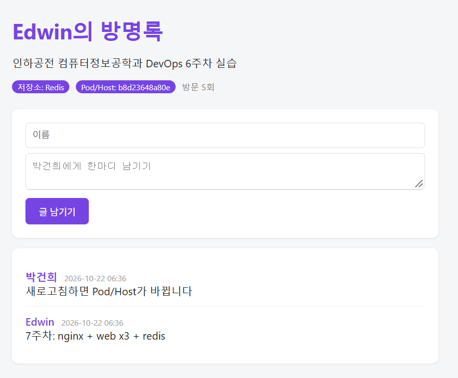
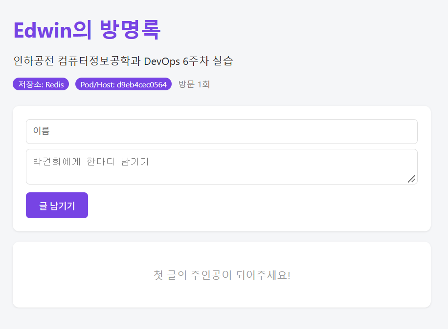

# 7주차 - 도커 컴포즈 (Docker Compose)

> 컨테이너 하나 = 역할 하나. 여러 컨테이너의 구성을 `compose.yaml` 파일 하나(코드)로 정의하고 함께 실행한다.

## 오늘 배운 내용

- 6주차 방명록은 글이 **프로세스 메모리**에 있어서 재시작하면 사라졌다 → DB(Redis)를 **다른 컨테이너**로 분리
- **compose.yaml** = 악보, 서비스 = 악기 파트, `docker compose up` = 지휘자의 연주 시작
- **서비스 이름이 곧 DNS 주소**: `REDIS_HOST: "redis"`. 컴포즈가 네트워크를 만들고 서비스 이름을 내부 DNS에 등록해서 IP가 바뀌어도 이름으로 찾는다
- **볼륨**: 컨테이너는 일회용, 데이터는 볼륨에 영구 보관. `down`은 볼륨을 남기고 `down -v`는 볼륨까지 지운다
- `ports:`가 없는 서비스는 바깥에서 접근할 수 없다 → DB는 숨기고 문(nginx)만 연다
- **.env**로 비밀번호 분리, **healthcheck**로 "시작"이 아닌 "준비 완료" 확인, **nginx**로 web 여러 개에 요청 분배

## 구성도

```text
브라우저 :8080
     │
┌────▼────┐   nginx  : 바깥 문 (ports 8080:80), 리버스 프록시 + 로드 밸런싱
│  nginx  │
└────┬────┘
 ┌───┼───┐
web web web   web    : 앱 3개 (expose 5000, 바깥에 공개 안 함), healthcheck = /readyz
 └───┼───┘
┌────▼────┐
│  redis  │   redis  : 데이터 (볼륨 redis-data), 비밀번호는 .env
└─────────┘
```

## 파일

| 파일 | 역할 |
|---|---|
| [`guestbook/compose.yaml`](../guestbook/compose.yaml) | nginx + web(3개) + redis 정의 |
| [`guestbook/nginx.conf`](../guestbook/nginx.conf) | 요청을 `web:5000`으로 전달. `resolver 127.0.0.11`(도커 내부 DNS)로 web 3개의 IP를 돌아가며 사용 |
| [`guestbook/.env.example`](../guestbook/.env.example) | `.env` 양식. 실제 비밀번호가 든 `.env`는 내 PC에만 있음 |
| [`keep-web3.sh`](keep-web3.sh) | web을 항상 3개로 유지하는 감시 스크립트 (아래 참고) |

실습 전체는 [`scripts/run-week07.sh`](../scripts/run-week07.sh)로 순서대로 다시 실행하고, 결과는 [`results/`](results/)에 저장했다.

## 실습 결과

### 1. config로 미리 검사

`${...}`가 `.env` 값으로 채워진 최종 설정을 컨테이너를 띄우지 않고 확인한다.

<!-- RESULT: results/01-config.txt -->
```text
$ docker compose config --quiet && echo OK
OK
$ docker compose config | grep requirepass -A1
      - --requirepass
      - ********
```
<!-- /RESULT -->

`.env`가 없으면 `:?` 필수 값 검사에 걸려서 바로 멈춘다.

<!-- RESULT: results/02-config-error.txt -->
```text
$ REDIS_PASSWORD= docker compose config --quiet
error while interpolating services.web.environment.REDIS_PASSWORD: required variable REDIS_PASSWORD is missing a value: 비밀번호 설정 필요
```
<!-- /RESULT -->

### 2. docker compose ps (healthy 포함)

명령 하나로 네트워크 + 볼륨 + 컨테이너 5개(nginx 1, web 3, redis 1)가 뜨고, redis가 healthy가 된 뒤 web이, web이 healthy가 된 뒤 nginx가 시작한다.

<!-- RESULT: results/04-ps-healthy.txt -->
```text
$ docker compose ps
NAME                IMAGE            COMMAND                  SERVICE   CREATED          STATUS                    PORTS
guestbook-nginx-1   nginx:alpine     "/docker-entrypoint.…"   nginx     12 seconds ago   Up Less than a second     0.0.0.0:8080->80/tcp, [::]:8080->80/tcp
guestbook-redis-1   redis:7-alpine   "docker-entrypoint.s…"   redis     12 seconds ago   Up 11 seconds (healthy)   6379/tcp
guestbook-web-1     guestbook-web    "python app.py"          web       12 seconds ago   Up 6 seconds (healthy)    5000/tcp
guestbook-web-2     guestbook-web    "python app.py"          web       12 seconds ago   Up 5 seconds (healthy)    5000/tcp
guestbook-web-3     guestbook-web    "python app.py"          web       12 seconds ago   Up 5 seconds (healthy)    5000/tcp
$ docker inspect --format '{{.Name}} {{.State.Health.Status}}' $(docker compose ps -q)
/guestbook-redis-1 healthy
/guestbook-web-1 healthy
/guestbook-web-2 healthy
/guestbook-web-3 healthy
template parsing error: template: :1:18: executing "" at <.State.Health.Status>: map has no entry for key "Health"
$ docker compose logs web | grep -m3 Redis
web-3  | [INFO] Redis 연결 성공: redis:6379
web-1  | [INFO] Redis 연결 성공: redis:6379
web-2  | [INFO] Redis 연결 성공: redis:6379
```
<!-- /RESULT -->

### 3. scale 후 응답하는 컨테이너가 바뀜

같은 주소(`localhost:8080`)로 9번 요청했는데 `hostname`(컨테이너 ID)이 번갈아 바뀐다 → nginx가 web 3개에 요청을 나눠 준다.
글은 어느 web으로 가도 똑같다. 데이터는 redis 하나에 있기 때문이다.

<!-- RESULT: results/06-scale-hostnames.txt -->
```text
$ docker ps --format '{{.ID}} {{.Names}}' | sort -k2
64e915dadd44 guestbook-nginx-1
cf062a0301dc guestbook-redis-1
718d42adf5c9 guestbook-web-1
165deeae14e4 guestbook-web-2
45e318028ea9 guestbook-web-3
$ for i in 1 2 3 4 5 6 7 8 9; do curl -s localhost:8080/healthz; echo; done
{"hostname":"45e318028ea9","status":"ok"}

{"hostname":"718d42adf5c9","status":"ok"}

{"hostname":"718d42adf5c9","status":"ok"}

{"hostname":"165deeae14e4","status":"ok"}

{"hostname":"718d42adf5c9","status":"ok"}

{"hostname":"718d42adf5c9","status":"ok"}

{"hostname":"45e318028ea9","status":"ok"}

{"hostname":"718d42adf5c9","status":"ok"}

{"hostname":"718d42adf5c9","status":"ok"}
```
<!-- /RESULT -->

새로고침할 때마다 화면의 **Pod/Host**가 바뀐다.

| 새로고침 1 | 새로고침 2 | 새로고침 3 |
|---|---|---|
|  |  |  |

### 4. web만 재시작해도 글이 남음

데이터가 web이 아니라 redis 컨테이너(볼륨)에 있어서 web을 재시작해도 그대로다. 6주차의 "재시작하면 글이 사라지는" 문제가 해결됐다.

<!-- RESULT: results/07-restart-web.txt -->
```text
$ echo 재시작 전 글 개수: $(count_entries)
재시작 전 글 개수: 3
$ docker compose restart web
 Container guestbook-web-2  Restarting
 Container guestbook-web-1  Restarting
 Container guestbook-web-3  Restarting
 Container guestbook-web-2  Started
 Container guestbook-web-3  Started
 Container guestbook-web-1  Started
$ echo 재시작 후 글 개수: $(count_entries)
재시작 후 글 개수: 3
```
<!-- /RESULT -->

### 5. down 후 up vs down -v 후 up

<!-- RESULT: results/08-down-vs-down-v.txt -->
```text
$ echo down 전 글 개수: $(count_entries)
down 전 글 개수: 3
$ docker compose down
 Container guestbook-nginx-1  Stopping
 Container guestbook-nginx-1  Stopped
 Container guestbook-nginx-1  Removing
 Container guestbook-nginx-1  Removed
 Container guestbook-web-2  Stopping
 Container guestbook-web-1  Stopping
 Container guestbook-web-3  Stopping
 Container guestbook-web-1  Stopped
 Container guestbook-web-1  Removing
 Container guestbook-web-1  Removed
 Container guestbook-web-2  Stopped
 Container guestbook-web-2  Removing
 Container guestbook-web-2  Removed
 Container guestbook-web-3  Stopped
 Container guestbook-web-3  Removing
 Container guestbook-web-3  Removed
 Container guestbook-redis-1  Stopping
 Container guestbook-redis-1  Stopped
 Container guestbook-redis-1  Removing
 Container guestbook-redis-1  Removed
 Network guestbook_default  Removing
 Network guestbook_default  Removed
$ docker volume ls | grep redis-data
local     guestbook_redis-data
$ docker compose up -d
 Network guestbook_default  Creating
 Network guestbook_default  Created
 Container guestbook-redis-1  Creating
 Container guestbook-redis-1  Created
 Container guestbook-web-3  Creating
 Container guestbook-web-1  Creating
 Container guestbook-web-2  Creating
 Container guestbook-web-3  Created
 Container guestbook-web-2  Created
 Container guestbook-web-1  Created
 Container guestbook-nginx-1  Creating
 Container guestbook-nginx-1  Created
 Container guestbook-redis-1  Starting
 Container guestbook-redis-1  Started
 Container guestbook-redis-1  Waiting
 Container guestbook-redis-1  Healthy
 Container guestbook-web-2  Starting
 Container guestbook-web-2  Started
 Container guestbook-web-1  Starting
 Container guestbook-web-1  Started
 Container guestbook-web-3  Starting
 Container guestbook-web-3  Started
 Container guestbook-web-2  Waiting
 Container guestbook-web-1  Waiting
 Container guestbook-web-3  Waiting
 Container guestbook-web-2  Healthy
 Container guestbook-web-1  Healthy
 Container guestbook-web-3  Healthy
 Container guestbook-nginx-1  Starting
 Container guestbook-nginx-1  Started
$ echo down 후 up, 글 개수: $(count_entries)
down 후 up, 글 개수: 3
$ docker compose down -v
 Container guestbook-nginx-1  Stopping
 Container guestbook-nginx-1  Stopped
 Container guestbook-nginx-1  Removing
 Container guestbook-nginx-1  Removed
 Container guestbook-web-3  Stopping
 Container guestbook-web-2  Stopping
 Container guestbook-web-1  Stopping
 Container guestbook-web-3  Stopped
 Container guestbook-web-3  Removing
 Container guestbook-web-3  Removed
 Container guestbook-web-2  Stopped
 Container guestbook-web-2  Removing
 Container guestbook-web-2  Removed
 Container guestbook-web-1  Stopped
 Container guestbook-web-1  Removing
 Container guestbook-web-1  Removed
 Container guestbook-redis-1  Stopping
 Container guestbook-redis-1  Stopped
 Container guestbook-redis-1  Removing
 Container guestbook-redis-1  Removed
 Network guestbook_default  Removing
 Volume guestbook_redis-data  Removing
 Volume guestbook_redis-data  Removed
 Network guestbook_default  Removed
$ docker volume ls | grep redis-data || echo '볼륨 없음'
볼륨 없음
$ docker compose up -d
 Network guestbook_default  Creating
 Network guestbook_default  Created
 Volume guestbook_redis-data  Creating
 Volume guestbook_redis-data  Created
 Container guestbook-redis-1  Creating
 Container guestbook-redis-1  Created
 Container guestbook-web-3  Creating
 Container guestbook-web-1  Creating
 Container guestbook-web-2  Creating
 Container guestbook-web-1  Created
 Container guestbook-web-2  Created
 Container guestbook-web-3  Created
 Container guestbook-nginx-1  Creating
 Container guestbook-nginx-1  Created
 Container guestbook-redis-1  Starting
 Container guestbook-redis-1  Started
 Container guestbook-redis-1  Waiting
 Container guestbook-redis-1  Healthy
 Container guestbook-web-2  Starting
 Container guestbook-web-2  Started
 Container guestbook-web-3  Starting
 Container guestbook-web-3  Started
 Container guestbook-web-1  Starting
 Container guestbook-web-1  Started
 Container guestbook-web-2  Waiting
 Container guestbook-web-3  Waiting
 Container guestbook-web-1  Waiting
 Container guestbook-web-2  Healthy
 Container guestbook-web-3  Healthy
 Container guestbook-web-1  Healthy
 Container guestbook-nginx-1  Starting
 Container guestbook-nginx-1  Started
$ echo down -v 후 up, 글 개수: $(count_entries)
down -v 후 up, 글 개수: 0
```
<!-- /RESULT -->

| 명령 | 지우는 것 | 데이터 |
|---|---|---|
| `docker compose down` | 컨테이너, 네트워크 | **남음** (볼륨 유지) |
| `docker compose down -v` | 컨테이너, 네트워크, **볼륨** | **사라짐** |

운영 환경에서 `-v`를 잘못 붙이면 데이터가 날아가므로 주의해야 한다.

### 6. 네트워크 격리

redis에는 `ports:`가 없어서 호스트에서는 접속이 안 되고, 같은 네트워크의 web에서는 `redis`라는 이름으로 접속된다.

<!-- RESULT: results/09-network.txt -->
```text
$ python3 -c "import socket; socket.create_connection(('127.0.0.1', 6379), timeout=2)" || echo '→ 호스트에서 redis 6379 접속 실패 (ports 없음)'
Traceback (most recent call last):
  File "<string>", line 1, in <module>
  File "/usr/lib/python3.12/socket.py", line 852, in create_connection
    raise exceptions[0]
  File "/usr/lib/python3.12/socket.py", line 837, in create_connection
    sock.connect(sa)
ConnectionRefusedError: [Errno 111] Connection refused
→ 호스트에서 redis 6379 접속 실패 (ports 없음)
$ docker compose exec web python -c "import socket; print('redis =', socket.gethostbyname('redis'))"
redis = 172.18.0.2
$ docker compose exec web python -c "import socket; socket.create_connection(('redis', 6379), 2); print('TCP 연결 성공')"
TCP 연결 성공
```
<!-- /RESULT -->

## .env를 Git에 올리지 않는 이유

- `compose.yaml`에 비밀번호를 그대로 적어 GitHub에 올리면 **전 세계에 공개**된다. 파일에서 지워도 **Git 이력에 남는다**
- 그래서 **설정(compose.yaml)은 Git에, 비밀 값(.env)은 Git 밖에** 둔다
  - `compose.yaml`에는 `${REDIS_PASSWORD}` 빈칸만 → 컴포즈가 같은 폴더의 `.env`를 자동으로 읽어 채움
  - `.env.example`에는 `REDIS_PASSWORD=비밀번호`처럼 **이름만** 적어서 친구가 자기 `.env`를 만들 수 있게 함
  - `.gitignore`의 `.env` → 실수로 커밋되는 것 방지 / `.dockerignore`의 `.env` → `COPY . .` 해도 이미지에 안 들어감
- 단, `.gitignore`는 **암호화가 아니다**. 내 PC의 `.env`는 평문 그대로이므로 PC 관리도 중요하다

## [중간 프로젝트 4번] web=3을 항상 유지하는 방법

수업 48쪽 호기심 문제: `docker stop`으로 web 하나를 멈추면 **아무도 살리지 않는다**. `restart: unless-stopped`는 사람이 직접 멈춘 컨테이너를 다시 켜지 않기 때문이다.

### 해결: 3단계로 막기

| 단계 | 방법 | 막아 주는 상황 |
|---|---|---|
| ① 시작할 때 3개 | `compose.yaml`의 `deploy.replicas: 3` | `--scale` 없이 `up`만 해도 3개. 명령어를 깜빡해도 됨 |
| ② 죽으면 다시 | `restart: always` | 앱이 에러로 종료, 도커 데몬/PC 재시작 |
| ③ 개수 감시 | [`keep-web3.sh`](keep-web3.sh) (조정 루프) | 사람이 `docker stop`, `docker rm -f`, healthcheck 실패(unhealthy) |

③이 핵심이다. 쿠버네티스가 하는 일을 셸 스크립트로 흉내 낸 것으로, **원하는 상태(web 3개, healthy)**와 **현재 상태**를 몇 초마다 비교해서 다르면 되돌린다.

```text
반복 (5초마다):
    running = 실행 중인 web 컨테이너 목록
    running 중 unhealthy 인 것 → docker restart
    개수(running) != 3 이면
        docker compose up -d --no-recreate --scale web=3 web
        # 멈춘 것은 다시 켜고, 없는 것은 새로 만들고, 멀쩡한 것은 건드리지 않음
```

### 실행 결과: 하나를 멈추고(stop), 하나를 지워도(rm) 3개로 복구

<!-- RESULT: results/10-keep-web3.txt -->
```text
$ docker compose ps web --format '{{.Name}} {{.Status}}'
guestbook-web-1 Up 6 seconds (healthy)
guestbook-web-2 Up 6 seconds (healthy)
guestbook-web-3 Up 6 seconds (healthy)
$ docker stop 36c08b9839a48f48d672bc84fa7b4ef8b7b5ce45fa429db0cbc83c35fdb63382 >/dev/null && echo 'web 하나 중지 (docker stop)'
web 하나 중지 (docker stop)
$ docker compose ps web --format '{{.Name}} {{.Status}}'
guestbook-web-1 Up 16 seconds (healthy)
guestbook-web-3 Up 16 seconds (healthy)
$ /home/edwin/devops/week07/keep-web3.sh --once
[15:36:31] web 실행 중 2개 (목표 3개) → 복구 시작
[15:36:32] 복구 완료 → web 3개
$ docker compose ps web --format '{{.Name}} {{.Status}}'
guestbook-web-1 Up 23 seconds (healthy)
guestbook-web-2 Up 6 seconds (healthy)
guestbook-web-3 Up 23 seconds (healthy)
$ docker rm -f d9eb4cec056446430415b2066bfc54b3787534ebda8359695502d38b767bd9e1 >/dev/null && echo 'web 하나 삭제 (docker rm -f)'
web 하나 삭제 (docker rm -f)
$ docker compose ps web --format '{{.Name}} {{.Status}}'
guestbook-web-1 Up 23 seconds (healthy)
guestbook-web-2 Up 6 seconds (healthy)
$ /home/edwin/devops/week07/keep-web3.sh --once
[15:36:39] web 실행 중 2개 (목표 3개) → 복구 시작
[15:36:40] 복구 완료 → web 3개
$ docker compose ps web --format '{{.Name}} {{.Status}}'
guestbook-web-1 Up 31 seconds (healthy)
guestbook-web-2 Up 13 seconds (healthy)
guestbook-web-3 Up 6 seconds (healthy)
```
<!-- /RESULT -->

계속 감시하려면 터미널 하나에서 실행해 둔다.

```bash
~/devops/week07/keep-web3.sh                 # Ctrl+C로 종료
nohup ~/devops/week07/keep-web3.sh > ~/keep-web3.log 2>&1 &   # 백그라운드 실행
```

### 장점, 단점, 한계

| | 내용 |
|---|---|
| **장점** | 수업에서 배운 것(compose, healthcheck, 셸 스크립트의 반복·조건·종료 코드)만으로 구현 가능. stop / rm / unhealthy를 모두 자동 복구. `--no-recreate`라 정상 컨테이너는 건드리지 않아 서비스 중단이 없음 |
| **단점** | 최대 `INTERVAL`(5초) + 컨테이너 기동 시간만큼은 2개로 동작 (그동안 nginx가 죽은 web으로 보낸 요청은 502가 날 수 있음). 스크립트를 따로 켜 둬야 하고, 일부러 줄이고 싶을 때도 다시 3개로 만들어 버림 |
| **한계** | 감시 스크립트 자체가 죽으면 아무도 살리지 않음 (감시자의 감시자 문제). 컴퓨터 **한 대** 안에서만 동작하므로 PC나 서버 자체가 고장 나면 소용없음. redis와 nginx는 1개라서 이들이 죽으면 web이 3개여도 서비스가 멈춤 → 여러 서버에 걸쳐 원하는 상태를 유지하려면 **쿠버네티스**(Deployment의 replicas, 자동 재스케줄링)가 필요 |

## 새로 배운 명령어

```bash
docker compose up -d [--build]        # 정의된 서비스 전부 실행
docker compose ps / logs -f web       # 상태, 로그
docker compose restart web            # web만 재시작
docker compose down [-v]              # 정리 (-v: 볼륨까지)
docker compose up -d --scale web=3    # web 3개
docker compose exec web sh            # 컨테이너 안으로
docker compose config --quiet         # 띄우기 전에 문법 검사
docker compose up --watch             # 파일 저장하면 자동 rebuild
docker volume ls / inspect            # 볼륨 확인
```
