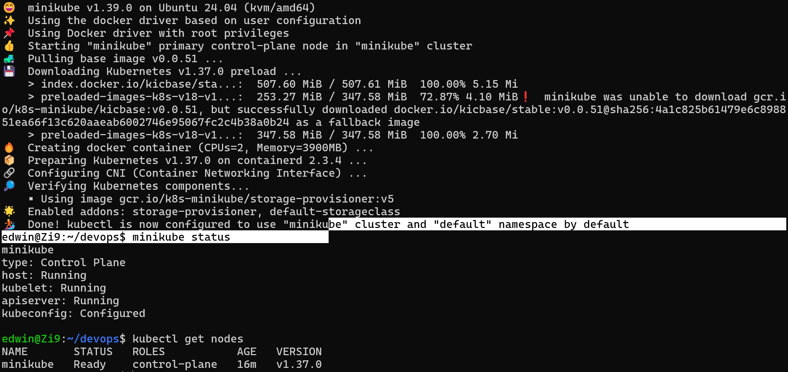
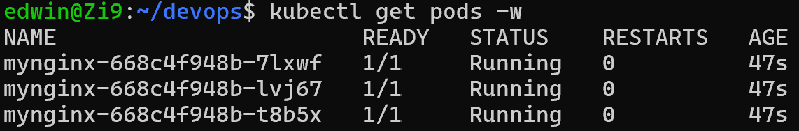
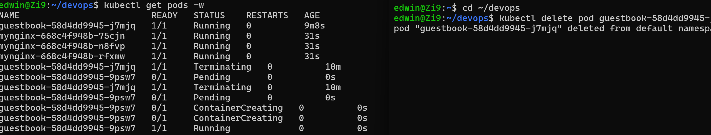
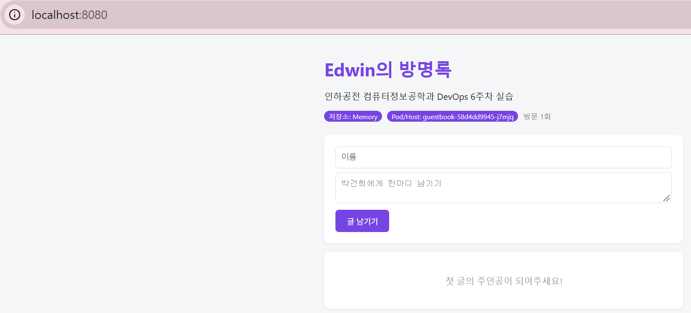

# 9주차 - 쿠버네티스 (Kubernetes)

> docker run은 컨테이너 하나, docker compose는 컴퓨터 1대, 쿠버네티스는 컴퓨터 수십 대에 걸쳐 **원하는 상태를 자동으로 유지**한다.

## 오늘 배운 내용

- **컴포즈의 한계**: 컴퓨터 1대 안에서만 동작하고, 서버가 고장 나도 다른 서버로 옮기지 못하며, 트래픽에 따라 자동으로 늘리거나 무중단 배포를 하려면 직접 구현해야 한다 → **오케스트레이션** 도구가 필요
- **쿠버네티스(k8s)** = 그리스어로 조타수. K와 s 사이에 글자가 8개라서 k8s
- **명령형 vs 선언형**
  - 명령형: `docker run`을 3번 하고, 죽으면 다시 run ("어떻게"를 지시)
  - 선언형: `replicas: 3`만 적으면 쿠버네티스가 알아서 3개를 유지 ("무엇을"만 선언)
- **조정 루프(reconciliation loop)**: 관찰(지금 2개) → 비교(원하는 건 3개) → 조치(1개 더 생성) → 다시 관찰
  - 7주차에 web=3을 유지하려고 만든 `keep-web3.sh`가 바로 이 조정 루프를 셸 스크립트로 흉내 낸 것이었다
- **클러스터 구조**

| 구성 요소 | 하는 일 | 식당 비유 |
|---|---|---|
| API Server | 모든 요청을 받는 창구 (kubectl이 말을 거는 곳) | 본사 접수 창구 |
| etcd | 클러스터의 모든 상태를 기록하는 DB | 본사 장부 |
| Scheduler | 새 Pod를 어느 노드에 둘지 결정 | "이 직원은 어느 지점으로?" |
| Controller | 원하는 상태와 현재를 비교해 맞춤 | 인원이 모자라면 채우는 매니저 |
| Node / kubelet | 실제로 컨테이너가 도는 서버 / 그 노드의 관리자 | 지점 / 지점장 |
| Pod | 컨테이너를 감싼 최소 배포 단위 | 직원 |

- `kubectl`은 직접 컨테이너를 띄우지 않는다. API Server에 원하는 것을 **등록**만 하고, 실제 실행은 노드의 kubelet이 한다
- **kubectl** = 리모컨, **minikube** = 노트북 안의 작은 TV(클러스터). 둘 다 있어야 한다
- **네임스페이스** = 한 클러스터 안의 칸막이 (`default`는 우리 구역, `kube-system`은 쿠버네티스 구역). 만들었는데 안 보이면 다른 구역인지 `-A`로 확인

## kubectl 문장 구조

```text
kubectl   get     pods    mynginx   -o wide
리모컨     동사     종류     이름      옵션
          get / describe / logs / exec / run / create / delete
                  pods(po) / deployments(deploy) / namespaces(ns)
                                    -o wide, -w(실시간), -A(모든 구역), -n(구역 지정), -l(레이블)
```

| docker | kubectl |
|---|---|
| `docker run -d --name web nginx` | `kubectl run web --image=nginx` |
| `docker ps` | `kubectl get pods` |
| `docker inspect web` | `kubectl describe pod web` (Events가 핵심) |
| `docker logs -f web` | `kubectl logs -f web` |
| `docker exec -it web sh` | `kubectl exec -it web -- sh` |
| `docker run -p 8080:80` | `kubectl port-forward web 8080:80` (확인용) |
| `docker rm -f web` | `kubectl delete pod web` |

## 실습 결과

사용한 도구: **kubectl + minikube** (`--driver=docker`, Ubuntu 24.04 WSL2)

### 1. 클러스터 만들기: kubectl get nodes

`minikube start --driver=docker`로 도커 컨테이너 하나를 노드 1대처럼 쓰는 클러스터를 만들었다. 노드가 `Ready`다.



### 2. 자가 치유: Pod를 지워도 다시 생긴다

`kubectl run`으로 만든 Pod는 지우면 그대로 사라졌다. 지켜보는 상위 관리자가 없기 때문이다.
`kubectl create deployment mynginx --image=nginx --replicas=3`으로 "3개가 있어야 한다"고 선언하자 Pod 3개가 떴다.



Pod 하나를 `kubectl delete pod`로 지웠더니, 아무 명령도 하지 않았는데 **이름이 다른 새 Pod**가 바로 만들어져 다시 3개가 됐다.
되살린 게 아니라 새로 만든 것이므로 Pod 안에 임시로 저장한 데이터는 사라진다.



```text
Deployment (mynginx)          원하는 개수와 업데이트 방식 관리
  └ ReplicaSet (668c4f948b)   Pod 개수 유지
      └ Pod (7lxwf, ...)      끝 5글자는 Pod마다 무작위
```

`kubectl scale deployment mynginx --replicas=5` / `--replicas=2`로 숫자 하나만 바꿔 늘리고 줄일 수 있었다. 컴포즈의 `--scale`과 다른 점은 그 숫자를 **계속 유지**한다는 것이다.

### 3. 내 이미지를 쿠버네티스에서 띄우기

6주차에 만든 `ghcr.io/zi90/guestbook:v2`를 Deployment로 띄우고 `port-forward`로 접속했다.

```bash
kubectl create deployment guestbook --image=ghcr.io/zi90/guestbook:v2
kubectl port-forward deployment/guestbook 8080:5000
```

화면의 `Pod/Host: guestbook-58d4dd9945-j7mjq`가 쿠버네티스 Pod 이름이다. 도커로 만든 이미지가 그대로 쿠버네티스에서도 돌아간다 (컨테이너 표준 덕분).



## 선언형을 내 말로

에어컨에 "26도"만 말하면 알아서 켜고 끄듯이, 쿠버네티스에는 "Pod 3개"라는 목표만 적어 두면 개수를 계속 세면서 알아서 맞춰 준다.

## 막혔던 것과 해결 방법

### 1. kubectl 다운로드가 40%에서 멈춤

수업 중 여러 명이 동시에 받느라 속도가 0이 되고 멈췄다. `Ctrl+C`로 끊고, 받은 곳부터 이어받는 옵션을 붙여 다시 받았다.

```bash
curl -LO -C - --retry 5 "https://dl.k8s.io/release/${K8SVER}/bin/linux/amd64/kubectl"
```

### 2. 내 이미지가 ErrImagePull → ImagePullBackOff

`kubectl logs`로는 "image can't be pulled"만 나와서 원인을 알 수 없었다. 컨테이너가 시작도 못 했기 때문이다.
슬라이드 순서대로 `kubectl describe pod`의 맨 아래 **Events**를 보니 원인이 적혀 있었다.

```text
Failed to pull image "ghcr.io/zi90/guestbook:v2": ... failed to fetch anonymous token:
... 401 Unauthorized
```

ghcr 패키지가 **Private**이라서 클러스터가 로그인 없이(anonymous) 이미지를 받지 못한 것이었다.
노트북에 이미 있는 이미지를 minikube 노드에 직접 넣고, 실패한 Pod를 지워 새로 만들게 해서 해결했다.

```bash
minikube image load ghcr.io/zi90/guestbook:v2
kubectl delete pod -l app=guestbook     # Deployment가 새 Pod를 만들면서 넣어 둔 이미지를 사용
```

배운 점: 막히면 **get pods → describe pod(Events) → logs** 순서로 본다. 에러의 답은 대부분 화면에 이미 적혀 있다.

## 새로 배운 명령어

```bash
minikube start --driver=docker / minikube status / minikube stop / minikube delete
minikube image load 이미지          # 로컬 이미지를 클러스터 노드에 넣기
kubectl version --client
kubectl get nodes -o wide / kubectl cluster-info
kubectl config current-context / get-contexts / use-context 이름
kubectl get pods [-w] [-A] [-n 구역] [-l app=이름]
kubectl run mynginx --image=nginx
kubectl describe pod 이름            # 맨 아래 Events부터
kubectl logs [-f] 이름 / kubectl logs -l app=guestbook
kubectl exec -it 이름 -- bash
kubectl port-forward 이름 8080:80 / port-forward deployment/guestbook 8080:5000
kubectl create deployment 이름 --image=이미지 --replicas=3
kubectl get deploy,rs,pods
kubectl scale deployment 이름 --replicas=5
kubectl delete pod 이름 / delete pods --all / delete deployment 이름
```
